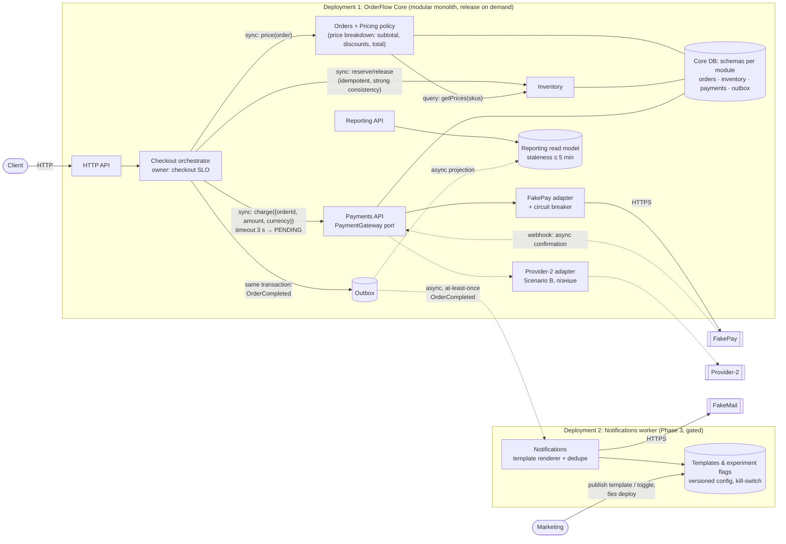

# OrderFlow: Final Architecture Report

> **Коротко:** OrderFlow залишається **modular monolith**, але зі зміцненими boundaries. Ми прибираємо три найдорожчі dependencies: Payments → Orders repository, синхронний email у checkout і Reporting, що читає таблиці всіх модулів. Notifications стає першим і поки єдиним кандидатом на **independently deployable worker**, але виділяється лише після виконання вимірюваних умов. Proposal «усі 5 модулів → services» **частково приймається (кроки 1–3) і відхиляється для кроку 4** щодо Orders, Inventory та Payments.
>
> AI Time to Market target: **75–90 днів (2,5–3 місяці)** замість 120. Ціль у 1 місяць за поточних умов **нереалістична**: навіть якщо взяти найкращі значення з таблиці improvements для кожного stage, сума становить 59 днів.

Умовні позначення: `file:line` посилаються на поточний код репозиторію. Hourly Cost = **$50/h** (як у `docs/analysis-tools.md`). Усі грошові оцінки є наближеннями з явними assumptions.

---

## 0. Assumptions, які використовуються в розрахунках

| # | Assumption | Звідки / чому defendable |
| --- | --- | --- |
| A1 | Середній чек ≈ $150, ≈ 14 400 замовлень/місяць (≈ 20/год), тобто revenue checkout ≈ $3 000/год | Продаж техніки; ціни seed-товарів $39–$279; 1 instance + резервний instance витримують навантаження |
| A2 | Під час checkout-інциденту втрачається ≈ 40% замовлень за час MTTR | Частина покупців повертається пізніше |
| A3 | Hourly Cost = $50 | `docs/analysis-tools.md` |
| A4 | Latency checkout з поточними параметрами FakePay/FakeMail: p50 ≈ 0,5 s, **p95 ≈ 2,5 s**, p99 ≈ 3,1 s | Моделювання 200k викликів за параметрами `src/config.js` |
| A5 | Ймовірність успіху checkout зараз = 0,95 (pay) × 0,98 (mail) ≈ **93,1%** | `src/config.js`: failureRate 5% та 2% |

---

## 1. Current architecture


**Responsibilities і dependencies (поточний стан):**

| Module | Responsibility | Залежить від | Проблема |
| --- | --- | --- | --- |
| Checkout | Оркестрація flow, compensation (release + fail) | Orders, Inventory, Payments, Notifications | Чекає email у критичному шляху (`CheckoutService.js:26`) |
| Orders | Draft, статуси, total | OrderRepository, **products з shared DB** (`OrderService.js:16`) | Pricing розмазаний між `shared/money.js` і Orders |
| Inventory | Reserve/release з idempotency key | Shared DB (`products`, `inventoryOperations`) | Boundary коректний ✅ |
| Payments | Виклик provider, запис payment | **OrderRepository** (в оригіналі), provider | Boundary leak, немає timeout, немає статусу PENDING |
| Notifications | Формування та sync-відправка email | Provider, shared DB | Template захардкожений у коді (`NotificationService.js:10`) |
| Reporting | Sales summary, operational health | **Колекції всіх модулів** | Full scan in-process (`ReportingService.js:7`), O(orders × payments) |

---

## 2. Які проблеми справді видно (Q1)

| # | Проблема | Evidence: code | Evidence: metrics / business |
| --- | --- | --- | --- |
| P1 | **Payments читає Orders repository напряму.** Будь-яка зміна моделі Order ламає Payments | `PaymentService` отримував `orderRepository` і викликав `findById` (оригінальний `PaymentService.js:11-12`) | 48% feature PR торкаються Orders і Payments одночасно |
| P2 | **Email у критичному шляху checkout.** Якщо падає email, **гроші вже списані, а order стає FAILED і stock повертається** | `CheckoutService.js:26-27` + catch `:35-36`. Перевірено експериментом: `order=FAILED, payment=CAPTURED, stock=12` | 37% змін templates вимагали повного regression checkout. Email додає ≈ 300 ms до p95. ≈ 1,9% усіх checkout потрапляють у стан «charged but failed» |
| P3 | **Немає timeout/fallback для payment provider.** Повільний provider блокує checkout | `PaymentService.js:35` чекає без обмеження | Два останні інциденти почалися під час payment latency spikes. MTTR 35 → 95 хв |
| P4 | **Reporting читає operational data всіх модулів у тому самому process** | `ReportingService.js:7-30`: `find` усередині `map` (квадратична складність); `productPerformance` бере **поточну** ціну товару (`:48`), а не ціну на момент замовлення | Reporting traffic ×3 за рік, очікується ×8–10. Scenario F: discount не потрапить у звіт коректно |
| P5 | **Pricing не має власника.** Total рахується через `shared/money.js` з таблиці products Inventory | `OrderService.js:16` | Scenario F (discount щомісяця) зачепить Orders, shared, Payments, Reporting, Notifications |
| P6 | **Один release train і один rollback scope** | Один artifact | Releases 5 → 2 на тиждень, Rollback 2% → 9%, Lead Time 2 → 6 днів |

**Що НЕ є проблемою (не будь-який coupling є помилкою):**
- Синхронна взаємодія Checkout → Inventory → Payments → Orders у межах одного process. Вона дає прості strong-consistency гарантії, які вимагає Scenario D.
- Inventory idempotency через `operationKey` (`InventoryService.js:9-11`) працює правильно, і тест це підтверджує.
- Checkout як явний orchestrator. Compensation логіка зосереджена в одному місці, що добре для Local Reasoning.
- Provider injection через `createApplication(options)` вже створює adapter seam.

**Що metrics не доводять:** частина росту Deployment Duration (8 → 27 хв) пояснюється розширенням test suite та ручними approvals, тобто це **process**, а не architecture. Кореляцію «більше modules → більше rollback» треба перевірити (див. falsification у §8).

---

## 3. Architectural characteristics, за пріоритетом (Q2)

| Пріоритет | Characteristic | Чому саме так | Response measure |
| --- | --- | --- | --- |
| 1 | **Availability & Resilience of checkout** | Checkout = revenue. Business прямо ставить availability вище за миттєвий email | Checkout success rate ≥ 99,5% без урахування відмов банку; p99 ≤ 3,5 s навіть під час provider spikes |
| 2 | **Data integrity (Inventory / Payments)** | Overselling і «гроші списані без замовлення» дорожчі за затримку | 0 подвійних змін stock; 0 «CAPTURED + FAILED» orders |
| 3 | **Modifiability** для Payments, Notifications, Pricing | Саме ці модулі змінюються найчастіше (Scenarios A, B, F) | Modules Changed per Feature < 2,5 |
| 4 | **Deployability** (менший blast radius, частіший release) | Спільний release train створює чергу, rollback 9% | Lead Time ≤ 3 дні, Rollback < 4% |
| 5 | **Scalability of Reporting** | Горизонт 12 місяців, staleness у кілька хвилин прийнятний | Checkout p95 не росте > 5% під 10× report load |

**Чим свідомо жертвуємо:**
- **Негайністю email.** Confirmation приходить eventual (p95 ≤ 5 хв), а не в HTTP-відповіді.
- **Свіжістю reports.** Read model може відставати до 5 хв.
- **Незалежним scaling та deployment більшості модулів.** Orders, Inventory та Payments залишаються в одному artifact.
- **Чистотою «кожен модуль = власна БД».** Окремі logical schemas в одній БД, а не окремі servers.
- **Трохи більшою кількістю infrastructure:** outbox, background dispatcher, template config.

---

## 4. Cost-of-change drivers (Q3)

| Rank | Dependency | Чому дорога | Scenario |
| --- | --- | --- | --- |
| 1 | **Checkout → Notifications (sync) + template у коді** | Найчастіша зміна (2–3 рази на тиждень) потребує deploy усього app і regression checkout | A, E |
| 2 | **Payments → Orders repository** | Couples дві найактивніші зони, тому кожна зміна Order schema стає зміною Payments | B, F |
| 3 | **Reporting → таблиці всіх модулів** | Будь-яка schema-зміна в Orders, Payments чи Notifications ламає звіти | C, F |
| 4 | **Orders → products (pricing через shared)** | Discount rules не мають місця і розмазуються | F |
| 5 | **Shared release train** (process-level coupling) | Будь-яка зміна чекає вікна, rollback забирає чужі зміни | Усі |

---

## 5. Proposed architecture



Легенда: суцільна стрілка означає synchronous виклик, пунктирна означає asynchronous або майбутній крок. Дві deployment boundaries: **Core** і **Notifications worker**.

### Evolution plan (не rewrite, feature delivery не зупиняється)

| Phase | Термін | Що робимо | Вже зроблено |
| --- | --- | --- | --- |
| 0 | Тиждень 1–2 | Baseline metrics; fitness functions у CI | ✅ `tests/architecture.test.js` |
| 1 | Тиждень 1–4 | Explicit contracts: Payments отримує amount через contract; Orders бере ціни через Inventory query API; Payment port + timeout + idempotency key + статус `PENDING` | ✅ Payments → Orders leak прибрано |
| 2 | Тиждень 4–10 | Outbox + in-process dispatcher для Notifications і Reporting projection; templates як versioned config з feature flags | — |
| 3 | Місяць 3–6, **gated** | Notifications worker як окремий deploy; release Core щодня | — |
| 4 | Місяць 9–12, **gated** | Reporting як окремий data store/service, тільки якщо виконано тригер з §11 | — |

Кожен крок займає ≤ 1 sprint і використовує 15–20% capacity. Feature delivery триває паралельно.

---

## 6. Відповіді на architecture decision task

**Q4. Які boundaries залишити без змін?**
- **Inventory**: reserve/release з persisted idempotency key і синхронним викликом із Checkout. Scenario D вимагає strong consistency. Перехід на async або окремий service створив би саме ті duplicate operations, яких бізнес боїться.
- **Checkout як orchestrator** (а не choreography через events). Компенсація в одному місці, легко тестувати й міркувати локально.
- **Orders, Inventory та Payments в одному process і одній БД.** Резервування до списання і release при помилці працюють без saga та distributed transaction.
- **`shared/errors.js`** як маленький shared kernel. Він стабільний і не створює cost of change.

**Q5. Які boundaries змінити?**
1. **Payments ↔ Orders.** Explicit contract `chargeOrder({orderId, amountCents, currency}, token)` замість читання чужого repository (**реалізовано**).
2. **Checkout ↔ Notifications.** Із sync-виклику на подію `OrderCompleted` через outbox. Templates переходять із коду в versioned config.
3. **Reporting ↔ operational data.** Reporting читає власний read model (projection з подій), а не таблиці інших модулів.
4. **Pricing.** Явна Pricing policy всередині Orders, яка повертає price breakdown (`subtotal`, `discounts[]`, `total`). Ціни Orders отримує через query API Inventory, а не з чужої таблиці.
5. **Payments ↔ provider.** Port + adapters, timeout, circuit breaker, idempotency key, статус `PENDING` і webhook для async confirmation (Scenario B).

**Q6. Чи залишається modular monolith доречним?** **Так.** Причини:
- 8 engineers + 2 QA і **немає platform team**.
- Навантаження обслуговує 1 instance.
- Orders, Inventory та Payments потребують strong consistency.
- Головні проблеми лежать у boundaries всередині monolith і в process, а не в тому, що всі модулі живуть в одному process.

**Q7. Чи має якийсь module стати independently deployable?** **Так, але лише один, Notifications, і лише після виконання умов (Phase 3).** Чому саме він:
- найвища частота змін (Scenario A);
- business прямо приймає eventual delivery;
- немає synchronous API для клієнта, тож не потрібна distributed consistency;
- його failure не впливає на revenue.

**Q8. Який module виділити першим?** **Notifications**, як async worker, що споживає `OrderCompleted`. **Не Payments:**
- потрібна синхронна відповідь клієнту;
- потрібна consistency з Order;
- обов'язковий human review security та finance;
- виділення не прибирає latency provider, а лише додає network hop.

**Не Reporting:** спочатку масштабуємо **дані** (read model), а не service. **Не Inventory:** через Scenario D.

**Q9. Trade-offs і нові failure modes:** див. §7 і §9 (R3, R4 створює саме наше рішення).

**Q10. Evidence:** §2 (code + metrics), §10 (change cost), реалізоване покращення та fitness tests (§8).

### Quality attribute scenarios (з `docs/change-scenarios.md`)

| Scenario | Stimulus | Response | Affected components | Response measure | Рішення |
| --- | --- | --- | --- | --- | --- |
| A Notifications | Marketing змінює template або вимикає експеримент | Зміна публікується як config, без app deploy | Notifications, template config | ≤ 1 год до prod; kill-switch ≤ 5 хв; 0% змін потребують checkout regression | Templates як config + async |
| B Payment provider | Новий provider або outage основного | Routing через port; async confirm → `PENDING` → webhook | Payments (+ обробка `PENDING` у Checkout) | Новий provider = зміна в 1 module; failover ≤ 1 хв після відкриття breaker | Adapter, **без** виділення service |
| C Reporting ×8–10 | Довгі date ranges, частіші запити | Відповідь із read model | Reporting, projection | Checkout p95 змінюється ≤ 5% під 10× report load; staleness ≤ 5 хв | Read model; виділення лише за тригером |
| D Inventory idempotency | Повторний reserve/release | Stock змінюється рівно 1 раз | Inventory | 0 подвійних змін (тест) | **Без змін**, sync in-process |
| E Checkout availability | Provider відповідає 2–3 s або недоступний | Bounded latency; email поза критичним шляхом | Checkout, Payments | p99 ≤ 3,5 s; падіння email має 0% впливу на успіх checkout; email p95 ≤ 5 хв | Timeout + breaker + outbox |
| F Discount | Нове discount rule щомісяця | Клієнт бачить правильну суму до списання; Reporting бачить discount | Orders/Pricing (+ мапінг у Reporting) | ≤ 2 modules змінено; сума показана клієнту = сума списана (100%) | Pricing policy в Orders, **sync** |

Не кожен scenario потребує нового service: A і C вирішуються async-взаємодією всередині monolith, D вимагає залишити все як є.

---

## 7. Decision summary

```text
Problem
  Проста зміна дедалі частіше зачіпає 4+ modules і чекає спільний release train.
  Checkout, найважливіший для revenue flow, залежить від двох зовнішніх
  providers синхронно (payment без timeout, email у критичному шляху).

Evidence
  Modules Changed per Feature 1,7 → 4,3; 48% PR зачіпають Orders+Payments;
  37% змін template вимагали regression checkout; 2 останні інциденти почалися
  з payment latency; Rollback 2% → 9%; Lead Time 2 → 6 днів; MTTR 35 → 95 хв.
  Code: Payments читав OrderRepository; email у checkout; Reporting сканує
  чужі колекції. Експеримент: падіння email після оплати дає
  order=FAILED, payment=CAPTURED, stock повернуто.

Decision
  Зберегти modular monolith і зміцнити boundaries (explicit contracts, data ownership).
  Винести email і reporting projection з критичного шляху через outbox.
  Payments: port + adapters + timeout + PENDING, але в тому самому process.
  Notifications стає окремим deployable worker лише після виконання тригерів.
  Proposal «5 services»: кроки 1–3 приймаються, крок 4 відхиляється для
  Orders/Inventory/Payments.

Trade-offs
  + Ізоляція checkout від email, менший scope змін і тестування, частіший release.
  − Eventual email/report (до 5 хв), at-least-once delivery (можливі дублікати),
    новий стан PENDING і reconciliation, outbox та worker треба моніторити.
  − Payments не отримує independent deployment: свідомо платимо спільним
    release за простоту consistency.

How we will measure success
  Modules Changed per Feature 4,3 → < 2,5; Lead Time 6 → ≤ 3 дні;
  Rollback 9% → < 4%; MTTR 95 → < 45 хв; template changes, що вимагають
  checkout regression, 37% → 0%; checkout p99 ≤ 3,5 s; fitness tests зелені в CI.
```

### Non-obvious trade-offs

1. **Timeout на payment переводить latency-проблему в consistency-проблему.** Якщо checkout перериває очікування через 3 s, а provider фактично списав гроші, стан платежу невідомий. Тому timeout **неможливий без** idempotency key (`orderId` як `reference`), статусу `PENDING`, утримання reservation та reconciliation job.
   - Timeout 2,5 s за поточної конфігурації (10% повільних викликів 1,5–3 s) відправляв би в `PENDING` ≈ **3,3%** платежів, тобто ≈ 480 на місяць.
   - Тому обрано timeout **3 s**. Платимо вищим p99 за меншу кількість невизначених станів.
2. **Async email покращує availability, але змінює контракт для клієнта.** HTTP-відповідь checkout більше не містить `notification`, Reporting показує `notificationStatus = PENDING`, а at-least-once delivery дає можливі **дублікати** листів. Потрібен dedupe key `orderId + template`.
3. **Discount не можна робити async.** Хоча event-driven підхід знижує coupling, клієнт мусить бачити правильну суму **до** списання (Scenario F). Тому Pricing залишається синхронною частиною Orders.

---

## 8. Principles

| Principle | Де порушено зараз | Що змінює proposal |
| --- | --- | --- |
| **Information Hiding** | Payments знав про внутрішній OrderRepository; Reporting знає структуру `orders`, `payments`, `notifications`, `products`; Orders читає таблицю products | Модулі бачать лише публічний contract або подію; таблиці стають private для модуля-власника |
| **Explicit Contracts** | `chargeOrder(orderId)` неявно вимагав, щоб Payments дістав order сам; email-контракт захований у checkout | `chargeOrder({orderId, amountCents, currency})` (**реалізовано**); подія `OrderCompleted` з versioned schema; contract tests між модулями |
| **Low Coupling** (зокрема temporal coupling) | Checkout тимчасово зв'язаний із FakeMail: email failure ламає оплачене замовлення | Outbox розриває temporal coupling; timeout і breaker обмежують coupling із FakePay |
| **Design for Change** | Template у коді; pricing у `shared/money.js` без власника | Templates як config і kill-switch; Pricing policy як точка розширення для discount rules; payment adapters для другого provider |
| **Fitness Functions** | Boundaries нічим не захищені, тому leak з'являється знову при наступній (зокрема AI-generated) зміні | Dependency rules як автоматичні тести в CI (**реалізовано**) + metric thresholds |

Дотримано вже зараз: **High Cohesion** в Inventory (idempotency в одному місці), **Local Reasoning** у Checkout (compensation в одному catch).

---

## 9. Risk analysis

`Expected Risk Cost = Probability × Business Impact` (за місяць, якщо не вказано інше). Assumptions A1–A3 з §0.

| # | Risk | Probability | Business Impact | Expected Risk Cost | Mitigation |
| --- | --- | --- | --- | --- | --- |
| R1 | Payment provider latency spike блокує checkout (**поточний**) | 0,8/міс (≈ 1 з 5 інцидентів/міс пов'язаний із payment) | 1,6 год MTTR × $3 000 × 40% = $1 900 + recovery 3 eng × 2 год × $50 = $300 + support/reputation $800 ≈ **$3 000** | **≈ $2 400/міс** | Timeout 3 s, circuit breaker, `PENDING`, пізніше fallback provider (B). Після цього impact ≈ $800, ERC ≈ $650 |
| R2 | Email падає після списання: «charged but FAILED», stock повернуто (**поточний**, підтверджений експериментом) | ≈ 1 (подія повторюється щомісяця): 1,9% × 14 400 ≈ 274 замовлення | 274 × $15 (support, refund/reconciliation) ≈ $4 100 + ризик overselling | **≈ $4 000/міс** (при реальному failure rate email 0,5% ≈ $1 000) | Email поза критичним шляхом (outbox). Ризик зникає повністю. **Найвищий ROI першого кроку** |
| R3 | **Створює наше рішення:** outbox/worker зупиняється, листи губляться, затримуються або дублюються | 0,3/міс | 4 год stall × 20 замовлень = 80 клієнтів без листа, ≈ 30% звертаються × $10 + 4 год engineering ≈ $440 + reputation ≈ **$700** | **≈ $210/міс** | Outbox у тій самій транзакції; dedupe key; alert, якщо backlog age > 5 хв; replay tool; dead-letter |
| R4 | **Створює наше рішення:** timeout дає невизначений стан платежу (provider списав, checkout не дочекався) і подвійне списання при retry | 0,9/міс (≥ 1 випадок під час spikes) | ≈ 20 випадків × $40 (refund, support, chargeback) ≈ **$800** | **≈ $720/міс** | Idempotency key = `orderId`; `PENDING` утримує reservation; reconciliation кожні 5 хв; webhook; alert, якщо `PENDING` > 15 хв |
| R5 | Migration сповільнює roadmap (одноразовий) | 0,4 на квартал | 2 eng × 3 тиж × 40 год × $50 = **$12 000** + затримка feature | **≈ $4 800 одноразово** | Кроки ≤ 1 sprint, 15–20% capacity, strangler, fitness tests, без «великого вибуху» |
| R6 | Reporting ×8–10 деградує checkout (спільний process) | 0,5 протягом 12 міс | ≈ 6 піків × 2 год × $3 000 × 20% ≈ **$7 200** | **≈ $3 600/рік** | Read model, limits на date range, кеш; тригер виділення в §11 |

**Висновок з risk analysis:** R1 + R2 ≈ **$6 400/міс** поточного expected cost значно перевищують нові ризики R3 + R4 ≈ **$930/міс** і одноразову migration (R5). Це кількісно обґрунтовує Phase 1–2.

---

## 10. Change cost analysis

### Scenario A: новий notification experiment (2–3 рази на тиждень)

| Вимір | Поточна architecture | Запропонована architecture |
| --- | --- | --- |
| Modules touched | Notifications + Checkout (regression), спільний artifact | Лише template config (0 code modules); для зміни segmentation logic: 1 module |
| Engineering hours | Impl 2 + review 1 + coordination 2 + testing (0,37 × 8 + 0,63 × 3 ≈ 4,9) + release 1,5 ≈ **11,4 год** | Impl 1 + review 0,5 + preview/contract test 1 + publish 0,5 ≈ **3 год** |
| Coordination overhead | Чекати release window (2 рази на тиждень), узгодження з власниками checkout | Marketing і власник Notifications, без release window |
| Testing scope | У 37% випадків повний checkout regression | Template rendering + contract `OrderCompleted` |
| Deployment scope | Увесь app; rollback забирає всі зміни release | Config publish або Notifications worker; kill-switch ≤ 5 хв |
| Change Cost | 11,4 × $50 ≈ **$570** | 3 × $50 = **$150** |

**Architecture Tax** (baseline = запропонована architecture) ≈ $420 за експеримент × 2,5 на тиждень × 50 тижнів ≈ **$52 000/рік**. Інвестиція в outbox + templates-as-config ≈ 100–120 год ≈ $6 000 окупається приблизно за 1,5 місяця.

### Scenario F: discount для payment methods і наборів товарів (щомісяця)

| Вимір | Поточна architecture | Запропонована architecture |
| --- | --- | --- |
| Modules touched | `shared/money.js`, Orders, Checkout, Payments (через спільну модель order), Reporting (ціна береться з products), Notifications (сума в email): **5–6** | Orders/Pricing policy + мапінг поля `discounts` у Reporting projection: **2** |
| Engineering hours | Impl 24 + coordination 8 (3 власники, 2 senior reviewers) + testing 16 (повний regression) + release 4 = **52 год** | Impl 16 + coordination 3 + testing 8 (unit pricing + contract tests + checkout smoke) + release 2 = **29 год** |
| Coordination overhead | Високий: спільне планування кількох модулів, finance review | Середній: finance review залишається (process constraint) |
| Testing scope | Увесь checkout + reports | Pricing rules + contract tests |
| Deployment scope | Увесь app | Core app (Notifications не зачеплено) |
| Change Cost | **$2 600** | **$1 450** |

Architecture Tax ≈ $1 150 за кожну зміну discount, тобто ≈ **$13 800/рік**. **Чому різниця:** у запропонованій architecture discount живе в одному власнику (Pricing policy) і поширюється через contract (`amountCents` у Payments, `discounts[]` у події), тому інші модулі не змінюються.

---

## 11. Metrics та Fitness Functions

### Metrics

| Metric | Зараз → Target (6 міс) | Чому важлива | Що спростує assumption |
| --- | --- | --- | --- |
| Modules Changed per Feature | 4,3 → **< 2,5** | Прямий індикатор coupling, який ми зменшуємо | Якщо після Phase 1–2 значення > 3,5 протягом 2 місяців, coupling **не є** головною причиною; переглядаємо process (PR size, планування) |
| Change Lead Time | 6 → **≤ 3 дні** | End-to-end швидкість, а не лише кодинг | Якщо Lead Time не падає, а Modules per Feature падає, bottleneck у review та release (process) |
| Rollback Rate | 9% → **< 4%** | Менший blast radius і scope | Якщо не падає, причина в якості змін, а не в architecture |
| MTTR | 95 → **< 45 хв** | Ізоляція failure modes | — |
| % template changes, що потребують checkout regression | 37% → **0%** | Перевірка розриву Checkout ↔ Notifications | > 0% означає, що boundary ще протікає |
| Checkout p99 latency / success rate | p99 ≈ 3,1 s, success ≈ 93% → **p99 ≤ 3,5 s під spikes, success ≥ 95% (лише відмови provider)** | Characteristic #1 | — |
| Notification delivery lag p95; outbox backlog age | нове → **≤ 5 хв** | Контроль нового ризику R3 | Росте означає, що async створює нові проблеми |
| Кількість `PENDING` > 15 хв | нове → **0** | Контроль ризику R4 | > 0 стабільно означає, що timeout надто агресивний |
| Notification **code** deploys на тиждень | ? → вимірюємо | Тригер для Phase 3 | Якщо < 1 на тиждень після templates-as-config, **виділення worker не потрібне** |

### Fitness Functions

**Реалізовано (`tests/architecture.test.js`, запускається через `npm test`):**

```text
FF1  Payments не імпортує нічого з orders/ і не згадує OrderRepository.
FF2  Payment provider implementation (FakePaymentProvider) використовується лише
     всередині payments/ та composition root app.js.
FF3  Notifications не імпортує orders/, payments/, inventory/, checkout/,
     тобто зміна notification template не потребує змін в Orders.
FF4  Contract test: PaymentService виконує charge через contract без жодних даних Orders.
```

Тест FF1 і FF4 **падають на оригінальному коді** (перевірено) і проходять після покращення. Отже, fitness function справді ловить порушення.

**Заплановано (Phase 1–2):**

```text
FF5  Checkout з notification provider, що відповідає 5 s або падає, завершується
     успішно, p95 < 1 s з тестовим payment provider. Падає сьогодні:
     доводить temporal coupling.
FF6  Reporting не читає колекції orders/payments/notifications напряму
     (dependency rule, після впровадження read model).
FF7  CI threshold: Checkout p99 ≤ 3,5 s у load test з PAYMENT_SLOW_RATE=0.3.
FF8  Review rule: новий cross-module import потребує ADR.
```

### Умови майбутньої architecture evolution (тригери)

| Крок | Тригер (будь-який з них) |
| --- | --- |
| Notifications worker → окремий deploy | Notification code deploys ≥ 1 на тиждень блокуються release train; templates-as-config покривають < 70% експериментів; email-навантаження впливає на ресурси Core |
| Reporting → окремий data store/service | Reporting traffic > 5× поточного; report queries > 20% CPU Core; checkout p95 росте > 10% під час report peaks; finance потребує > 12 міс історії |
| Payments → independently deployable | Другий provider з async confirmations у prod; payment changes ≥ 2 на тиждень блокуються release; поява окремої payments team; вимога ізоляції PCI scope |
| Ширший перехід до services | Команда > 15 engineers або ≥ 3 stream-aligned teams **і** є platform capability (CI/CD, observability, on-call) |
| Inventory | Не виділяється, доки немає multi-warehouse або окремого власника; strong consistency має пріоритет |

---

## 12. Proposal review: що прийнято, змінено, відхилено

| Proposal step | Рішення | Обґрунтування |
| --- | --- | --- |
| 1. Зафіксувати contracts | ✅ **Прийнято** | Почато: Payments contract + fitness tests |
| 2. Data ownership, прибрати доступ до чужих repositories | ✅ **Прийнято** | Payments ↔ Orders виконано; далі Orders ↔ products і Reporting |
| 3. Async messaging | 🔶 **Змінено** | Лише для Notifications і Reporting projection. **Не** для Orders, Inventory та Payments (Scenario D; Scenario F вимагає sync) |
| 4. Виділення services (усі 5) | ❌ **Відхилено зараз** для Orders, Inventory, Payments, Reporting; **змінено** для Notifications (gated) | Див. нижче |

**Чому складніша architecture ще не виправдана:**
- **Availability погіршиться, хоча вона є characteristic #1.** Зараз checkout має 2 зовнішні network-виклики. З 5 services додаються ще ≈ 4 internal hops. Якщо кожен має 99,9%, ланцюжок дає 0,999⁴ ≈ **99,6%** до врахування providers.
- **Не вистачає людей.** 8 engineers на 5 services означає ≈ 1,6 людини на service з on-call, pipeline та observability, а **platform team немає**.
- **Consistency стане дорожчою.** Orders, Inventory та Payments потребують reservation перед charge. Між services це saga + idempotency + reconciliation, тобто нові класи інцидентів, зокрема overselling (Scenario D).
- **Scaling не потрібен.** Навантаження обслуговує 1 instance, а Reporting можна масштабувати як дані (read model).
- **Частина деградації metrics має process-причини.** Ручні approvals, розширений test suite, 2 senior reviewers. Services їх не вирішують.

**Відповіді на open questions proposal:**
- **Хто відповідає за end-to-end checkout reliability?** Власник Checkout (орієнтовно Orders stream) з SLO checkout p99 і success rate.
- **Які consistency guarantees потрібні?** Orders, Inventory та Payments: strong (in-process). Notifications і Reporting: eventual ≤ 5 хв.
- **Чи виправдовує Reporting traffic окремий data store?** Поки ні. Спершу read model, далі за тригером.
- **Чи достатньо спершу покращити boundaries всередині modular monolith?** Так, і metrics з §11 це перевірять.

### Що свідомо НЕ змінюємо

- Modular monolith як основний deployment unit і один repository.
- Inventory boundary та синхронний reserve/release.
- Checkout як orchestrator (без choreography).
- Одна БД-технологія (logical schemas, а не окремі DB servers).
- Без message broker на кшталт Kafka чи RabbitMQ: достатньо outbox table + dispatcher. Broker додасть ще один компонент для команди без platform team.
- Без Kubernetes і service mesh.
- HTTP API для клієнтів.

---

## 13. AI та Time to Market (рівень 90+)

### 13.1 Перевірка assumption «developers у 4 рази швидші → TTM у 4 рази менший»

- **Implementation займає 40 з 120 днів (33%).** Навіть нескінченне прискорення implementation дає **80 днів**, а не 30 (закон Амдала).
- **«4 рази швидше» стосується написання коду, а не всього stage.** Implementation також включає design, очікування review (2 senior engineers), обов'язковий human review security та finance, rework.
- **AI-assisted зміни, ймовірно, збільшать навантаження на Integration і Validation.** Average PR Size уже 520 LOC, «більші PR довше чекають review», а зміни в кількох модулях потребують більше integration testing.
- **Немає baseline для defect rate AI-коду**, тому якість поки є невідомою змінною.

### 13.2 Оцінка по stages

Модель stage Implementation (40 днів) = coding ≈ 18 + review wait & rework ≈ 12 + design/clarification ≈ 10.

| Stage | Зараз | **AI-only** (нічого іншого не змінюємо) | **Target** (AI + investments) | Range | Assumptions |
| --- | ---: | ---: | ---: | ---: | --- |
| Analysis | 20 | 18 | **17** | 15–18 | AI прискорює research і prototype (−2…−3). Bottleneck: доступність stakeholders і людські рішення |
| Implementation | 40 | 25 | **20** | 18–28 | Coding 18 → 5 (≈ 4×). Design 10 → 8 (AI допомагає читати код) → 7. Review 12 → 12 (2 seniors, більші PR) → 8 з CODEOWNERS, PR ≤ 200 LOC, FF замість ручного architecture review |
| Integration | 25 | 27 | **18** | 15–22 | AI-only: більше паралельних змін, 4,3 modules per feature (+2). Target: explicit contracts, contract tests, ≤ 2,5 modules, друге test environment прибирає чергу 3–5 днів (−7) |
| Validation | 25 | 26 | **18** | 15–20 | AI-only: більше коду, немає defect baseline (+1). Target: automation + parallel testing (−7). Ефект нового environment **уже враховано** в Integration, щоб не рахувати overlap двічі |
| Release | 10 | 10 | **6** | 4–7 | Щоденне release window, менший scope, Notifications окремо (−4). Ручні approvals частково залишаються |
| **Total** | **120** | **106 (≈ 3,5 міс)** | **79 (≈ 2,6 міс)** | **67–95** | |

**Прогноз:** **75–90 днів (2,5–3 місяці)** для major feature після 6–9 місяців впровадження. Stretch target на 12 місяців: ≈ 60–65 днів (2 місяці).

**Коли benefit стане доступним (migration cost):** перший major feature під час Phase 1–2 буде **повільнішим** (≈ 110–125 днів), бо 15–20% capacity іде на contracts, outbox, test environment. Це J-curve: виграш з'являється з 2-го–3-го feature.

### 13.3 Які stages AI реально прискорює

- **Сильно:** coding частина Implementation (scaffolding, tests, refactoring), чернетки документації та тестів.
- **Помірно:** Analysis (research, prototype), Validation (генерація test cases, але виконання та environment не прискорюються).
- **Майже ні:** очікування review, security та finance review, черга на test environment, release window, рішення stakeholders.

### 13.4 Bottlenecks, які залишаться або перемістяться

1. **Review capacity:** 2 senior engineers. Bottleneck **переміщується** з coding на review: більше PR × більший розмір.
2. **Integration queue:** одне test environment, черга 3–5 днів, зростає з throughput.
3. **Validation:** 2 QA engineers на зрослий обсяг змін.
4. **Release window** 2 рази на тиждень і спільний scope.
5. **Human review** security та finance changes (Payments, Pricing).
6. **Доступність stakeholders** в Analysis.

### 13.5 Architecture constraints vs Process constraints

| Architecture constraints (обмежують throughput) | Process constraints (генерація коду їх не вирішує) |
| --- | --- |
| Спільний deployment artifact і release train | Review зосереджений на 2 senior engineers |
| Orders ↔ Payments coupling (48% PR) дає великі changesets | Ручні approval кроки в deployment |
| Sync Notifications у checkout: регресія checkout для template | Release window 2 рази на тиждень |
| Reporting читає чужі schemas: зміна schema ламає звіти | Одне test environment (infrastructure / planning) |
| Немає explicit contracts, тож потрібні integration tests замість contract tests | Обов'язковий human review security та finance |
| Pricing без власника: Scenario F зачіпає 5–6 modules | Немає baseline defect rate AI-коду; 2 QA; доступність stakeholders |

### 13.6 Чи реалістичний 1 місяць?

**Ні, за наявних умов.** Аргументи:
- AI-only дає ≈ 106 днів.
- Навіть **найкращі значення з таблиці improvements одночасно** (15 + 10 + 15 + 15 + 4) дають **59 днів**. Ці improvements частково overlap, тому реальна сума буде більшою.
- 30 днів неможливі в моделі «послідовна сума stages», хоч би як прискорювався код.

### 13.7 Що має змінитися для реального місячного delivery cycle

1. **Змінити одиницю доставки.** Major feature нарізається на інкременти, що релізяться незалежно за feature flags. Stages виконуються **паралельно** для різних інкрементів, а не послідовно для всієї feature.
2. **Dual-track discovery.** Analysis наступного інкременту йде паралельно з implementation поточного. Потрібен SLA на доступність stakeholders.
3. **Trunk-based development, PR ≤ 200 LOC**, review SLA ≤ 1 день, ≥ 4–5 reviewers з architecture knowledge (CODEOWNERS, ADR, pairing).
4. **Modules Changed per Feature ≤ 2** завдяки boundaries з цього звіту та contract tests замість повного integration testing.
5. **Ephemeral або друге test environment**, автоматизований regression ≤ 1 день.
6. **Continuous delivery:** release on demand щодня, без ручних approvals для low-risk змін, Notifications і config окремо.
7. **Security та finance review плануються з першого дня** (checklists, ранній review design), а не наприкінці.
8. **Виміряний baseline якості AI-коду.**

Навіть тоді 1 місяць реалістичний лише для feature, що зачіпає ≤ 2 modules і не потребує нового зовнішнього provider.

### 13.8 Prerequisites, investments і risks для target 75–90 днів

| Prerequisite / Investment | Оцінка | Risk |
| --- | --- | --- |
| Explicit contracts + contract tests | 60–80 год | Contracts застарівають без підтримки |
| Outbox + templates-as-config | 100–120 год | R3 (§9) |
| Payment port + timeout + `PENDING` + reconciliation | 40–60 год | R4 (§9) |
| Друге test environment | Infra cost щомісяця (бюджет може зрости, якщо результат вимірюваний) | Drift між environments |
| CODEOWNERS, ADR, навчання reviewers | ≈ 10% часу senior engineers | Тимчасове сповільнення seniors |
| Fitness functions у CI | ≈ 8 год (частково ✅) | False positives дратують команду |
| Разом одноразово | ≈ 250 год ≈ **$12 500** | R5 (§9) |

### 13.9 Нові risks від більшого implementation throughput

- **Review fatigue і rubber-stamping** великих AI-PR (520 LOC уже зараз), тому дефекти проходять у prod.
- **Ріст Change Failure Rate і Rollback** без baseline якості AI-коду.
- **Architecture erosion:** AI копіює існуючі патерни, зокрема leaks (прямий доступ до чужого repository). Mitigation: FF1–FF8 у CI.
- **Security та finance помилки** в Payments і Pricing у згенерованому коді.
- **Ріст WIP:** черга в Integration і Validation збільшується, тож Lead Time може **зрости**.
- **Ріст test suite** збільшує Deployment Duration.
- **Knowledge dilution:** код написаний швидше, ніж команда його розуміє, тому MTTR росте.

### 13.10 Як виміряти фактичний вплив AI (не LOC і не кількість PR)

- **End-to-end TTM major feature** і **час у кожному stage** (flow time, waiting vs working, flow efficiency).
- **Change Lead Time** і **review wait time**.
- **Change Failure Rate, Rollback Rate, escaped defects** для PR з AI-assisted label порівняно з іншими PR.
- **Rework rate:** частка коду, переписаного протягом 3 тижнів (code churn).
- **WIP і час очікування в integration queue.**
- **Modules Changed per Feature, PR size.**

### 13.11 Evidence, які змусять переглянути прогноз після першого major feature

| Спостереження | Перегляд |
| --- | --- |
| Implementation ≤ 12 днів **і** review wait < 2 днів | Можна знизити target до ≈ 65–70 днів |
| Integration queue > 5 днів | Implementation gain «з'їдено»; спочатку інвестиції в environment, target ≈ 90–100 днів |
| Defect rate AI-PR > non-AI на ≥ 30% | Знизити очікуваний gain implementation (40 → 28) і посилити review |
| Validation не скоротилась, хоча automation є | Bottleneck у QA capacity (2 особи), а не в інструментах |
| Modules Changed per Feature не < 3 | Boundaries не працюють; Integration estimate (18) переглянути вгору |

---

## 14. Optional implementation (evidence)

Реалізовано одне невелике boundary-покращення: **прибрано прямий доступ Payments до OrderRepository** і додано fitness functions.

| Файл | Зміна |
| --- | --- |
| `src/payments/PaymentService.js` | Конструктор `(database, provider)` замість `(database, orderRepository, provider)`; `chargeOrder({ orderId, amountCents, currency }, paymentToken)` з валідацією contract |
| `src/checkout/CheckoutService.js` | Checkout передає дані платежу через contract |
| `src/app.js` | Composition root більше не передає `orderRepository` у Payments |
| `tests/architecture.test.js` | FF1–FF4 |

`npm test`: **9/9 pass** (5 існуючих + 4 нових). `npm run demo` працює. FF1 і FF4 падають на оригінальному коді, тобто доводять, що boundary був порушений і тепер захищений.
