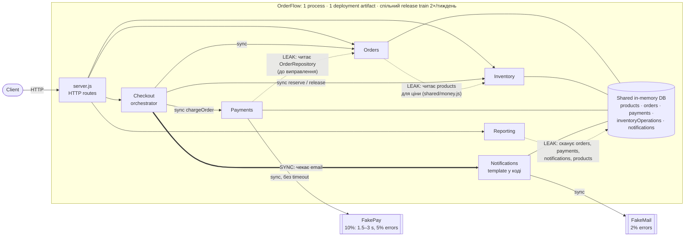

# OrderFlow: Final Architecture Report

## 1. Current architecture



---

## 2. Proposed architecture


Суцільна стрілка означає sync, пунктирна означає async або майбутній крок.

---

## 3. Decision summary

```text
Problem
  Проста зміна зачіпає 4+ modules і чекає спільний release train. Checkout,
  ключовий для revenue, синхронно залежить від двох зовнішніх providers
  (payment без timeout, email у критичному шляху).

Evidence
  Modules Changed per Feature 1,7 → 4,3; 48% PR зачіпають Orders+Payments;
  37% змін notification templates вимагали regression checkout; 2 останні
  інциденти почалися з payment latency; Rollback 2% → 9%; Lead Time 2 → 6 днів;
  MTTR 35 → 95 хв.
  Code: Payments читав OrderRepository; checkout чекає email (CheckoutService.js:26);
  Reporting сканує колекції всіх модулів. Експеримент: падіння email після
  оплати дає order=FAILED, payment=CAPTURED, stock повернуто.

Decision
  Зберегти modular monolith і зміцнити boundaries: explicit contracts,
  data ownership.
  Email і reporting projection перенести через outbox, поза критичний шлях.
  Templates стають versioned config з kill-switch.
  Payments: port + adapters + timeout 3 s + PENDING, в тому самому process.
  Notifications стає окремим deployable worker лише за тригерами.
  Proposal «5 services»: кроки 1–3 прийнято (крок 3 частково), крок 4 відхилено
  для Orders/Inventory/Payments/Reporting.

Trade-offs
  + ізоляція checkout від email, менший scope змін і тестування, частіший release;
  − eventual email і reports (≤ 5 хв), можливі дублікати листів (at-least-once),
    новий стан PENDING і reconciliation, outbox і worker треба моніторити;
  − Payments свідомо без independent deployment.

How we will measure success
  Modules Changed per Feature 4,3 → < 2,5; Lead Time 6 → ≤ 3 дні;
  Rollback 9% → < 4%; template changes з checkout regression 37% → 0%;
  checkout p99 ≤ 3,5 s; architecture fitness tests зелені в CI.
```

---

## 4. Principles

| Principle | Де порушено зараз | Як змінює proposal |
| --- | --- | --- |
| **Information Hiding** | Payments знав про `OrderRepository`; Reporting знає таблиці 4 модулів; Orders читає таблицю products | Модулі бачать лише public contract або подію; таблиці стають private |
| **Explicit Contracts** | `chargeOrder(orderId)` неявно змушував Payments самому шукати order | `chargeOrder({orderId, amountCents, currency})`; versioned подія `OrderCompleted` |
| **Low Coupling** (temporal) | Падіння FakeMail ламає вже оплачене замовлення | Outbox розриває temporal coupling; timeout і breaker обмежують залежність від FakePay |
| **Fitness Functions** | Boundaries нічим не захищені | Dependency rules як автоматичні тести в CI |

---

## 5. Risk analysis

`Expected Risk Cost = Probability × Business Impact` (за місяць). Assumptions: revenue checkout ≈ $3 000/год (≈ 14 400 замовлень × $150), Hourly Cost $50.

| # | Risk | Probability | Business Impact | Expected Risk Cost | Mitigation |
| --- | --- | --- | --- | --- | --- |
| R1 | Payment latency spike блокує checkout | 0,8 | ≈ $3 000 | **≈ $2 400** | Timeout 3 s, circuit breaker, `PENDING`, пізніше fallback provider |
| R2 | Email падає після оплати: «charged but FAILED» | ≈ 1 | ≈ $4 100 (≈ 274 замовлення × $15) | **≈ $4 000** | Email через outbox поза критичним шляхом |
| R3 | Outbox або worker зупиняється, листи губляться чи дублюються (**створює наше рішення**) | 0,3 | ≈ $700 | **≈ $210** | Outbox у тій самій транзакції, dedupe key, alert якщо backlog > 5 хв, replay |
| R4 | Timeout дає невизначений стан платежу (**створює наше рішення**) | 0,9 | ≈ $800 | **≈ $720** | Idempotency key = `orderId`, `PENDING` утримує reservation, reconciliation кожні 5 хв |
| R5 | Migration сповільнює roadmap (одноразово) | 0,4 на квартал | ≈ $12 000 | **≈ $4 800 разово** | Кроки ≤ 1 sprint, 15–20% capacity, fitness tests |

---

## 6. Metrics

| Metric | Зараз → Target (6 міс) | Чому важлива |
| --- | --- | --- |
| Modules Changed per Feature | 4,3 → < 2,5 | Прямий індикатор coupling між модулями |
| Change Lead Time | 6 → ≤ 3 дні | End-to-end швидкість доставки змін |
| Rollback Rate | 9% → < 4% | Менший blast radius і scope release |
| Template changes з checkout regression | 37% → 0% | Перевірка розриву Checkout ↔ Notifications |
| Checkout p99 latency | ≈ 3,1 s → ≤ 3,5 s навіть під provider spikes | Availability checkout, а отже revenue |
| Notification delivery lag p95 | нове → ≤ 5 хв | Контроль нового ризику R3 |

**Fitness Functions** (`tests/architecture.test.js`, запускаються через `npm test`):

```text
FF1  Payments не імпортує orders/ і не згадує OrderRepository.
FF2  Payment provider implementation доступна лише через Payments boundary (і composition root app.js).
FF3  Зміна notification template не потребує змін в Orders, Payments, Inventory.
FF4  Contract test: Payments виконує charge без жодних даних Orders.
```

---

## 7. AI та Time to Market

```text
TTM = Analysis + Implementation + Integration + Validation + Release
```

| Stage | Зараз | AI-only | **Target** | Range |
| --- | ---: | ---: | ---: | ---: |
| Analysis | 20 | 18 | **17** | 15–18 |
| Implementation | 40 | 25 | **20** | 18–28 |
| Integration | 25 | 27 | **18** | 15–22 |
| Validation | 25 | 26 | **18** | 15–20 |
| Release | 10 | 10 | **6** | 4–7 |
| **Total** | **120** | **106** | **79** | **67–95** |

**Target: 75–90 днів (2,5–3 місяці).** Ціль у 1 місяць за поточних умов нереалістична:
- Implementation займає лише 33% TTM;
- навіть найкращі значення improvements для всіх stages дають 59 днів;
- bottleneck переміщується з coding на review (2 senior engineers), integration queue (одне test environment), QA і release window.

**Для місячного циклу потрібно:**
- нарізати major feature на інкременти за feature flags і виконувати stages паралельно;
- ≤ 2 modules на зміну;
- contract tests;
- ephemeral test environment;
- щоденний release;
- ширшу review capacity